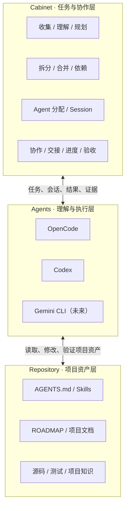
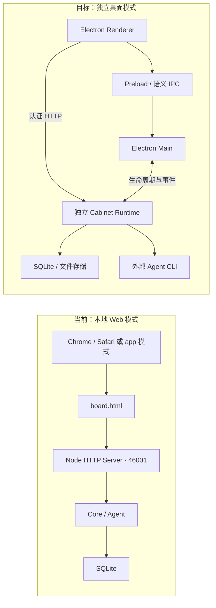
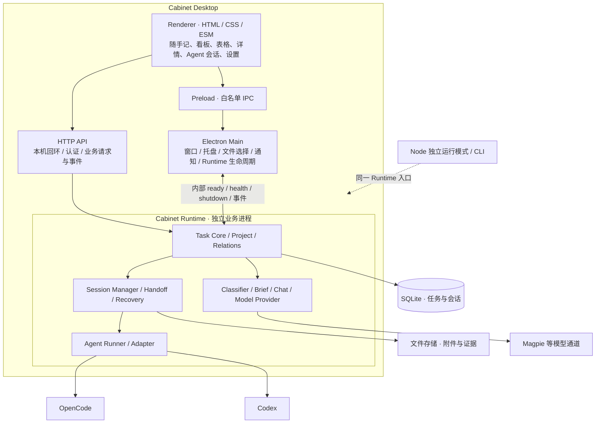
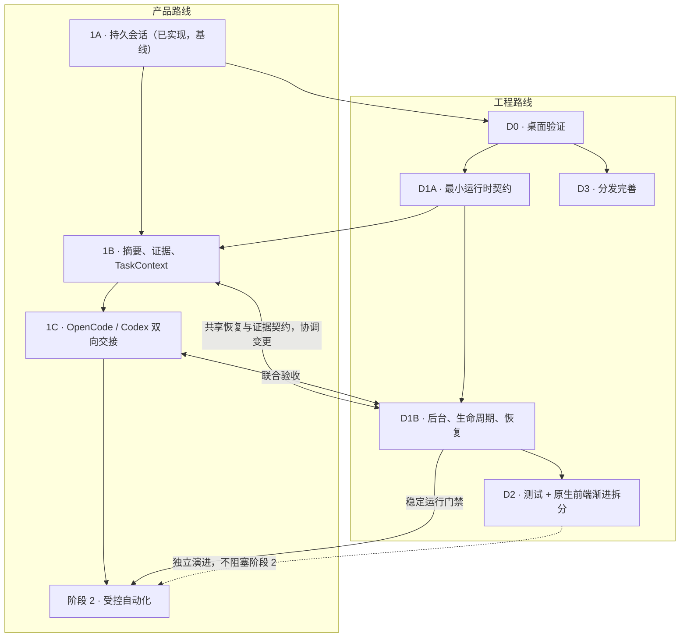
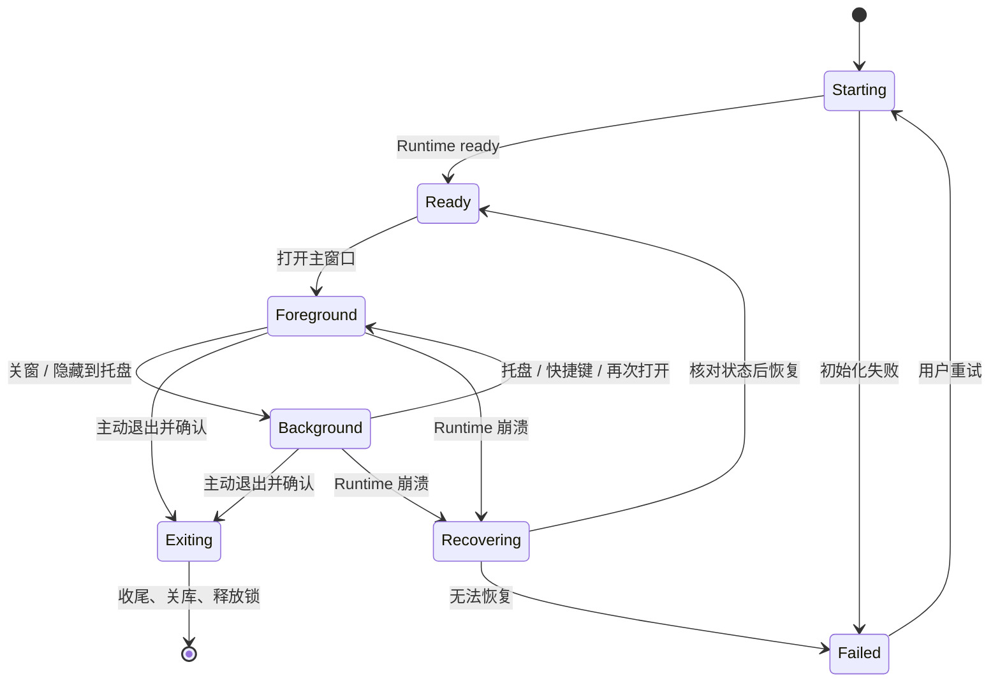
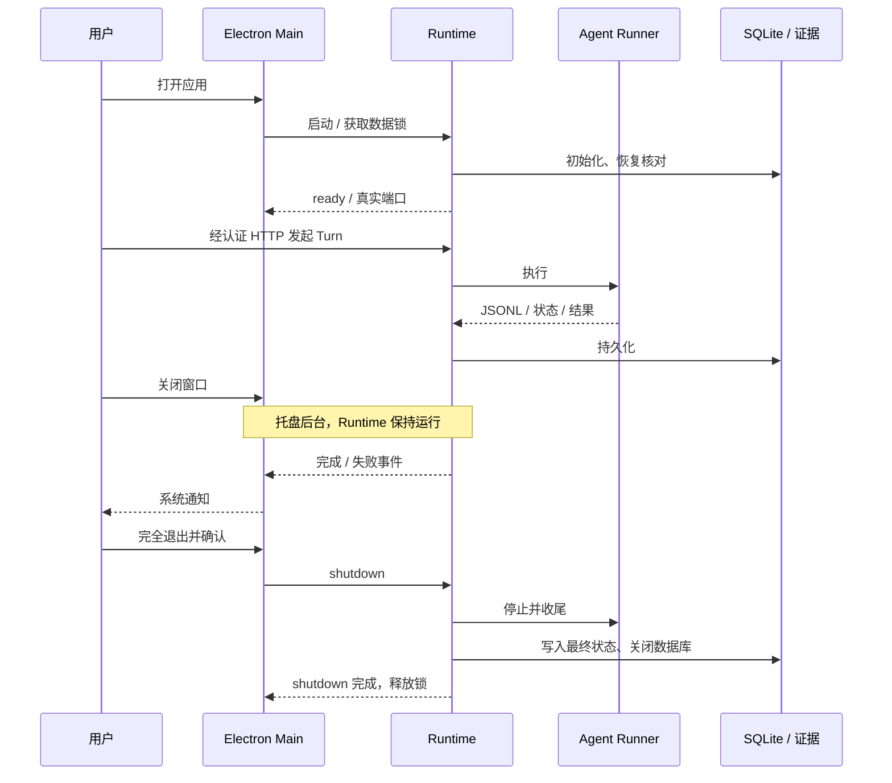
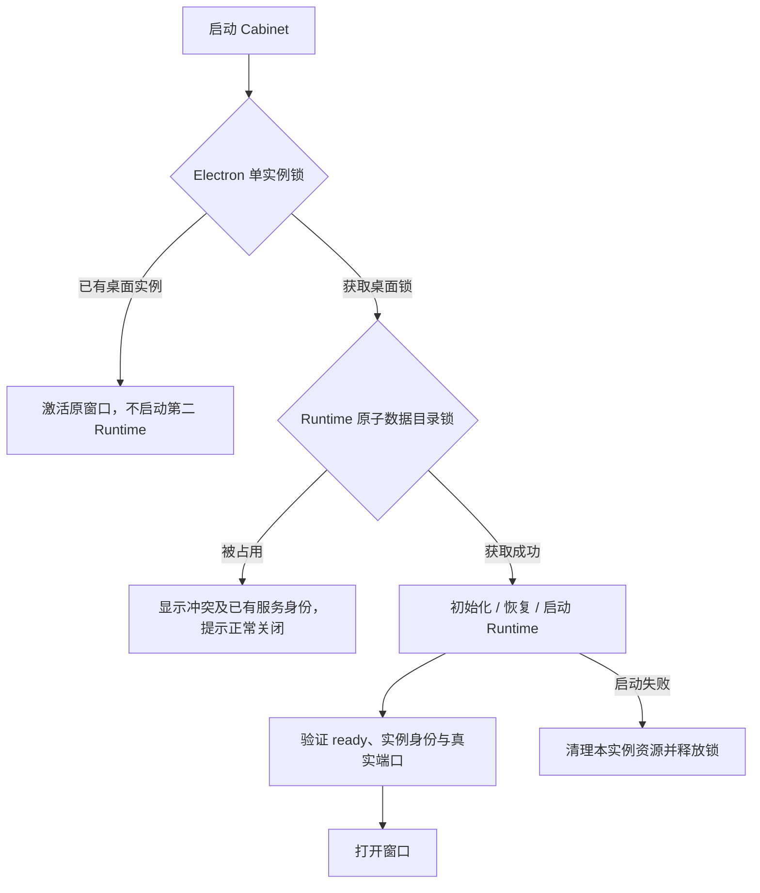
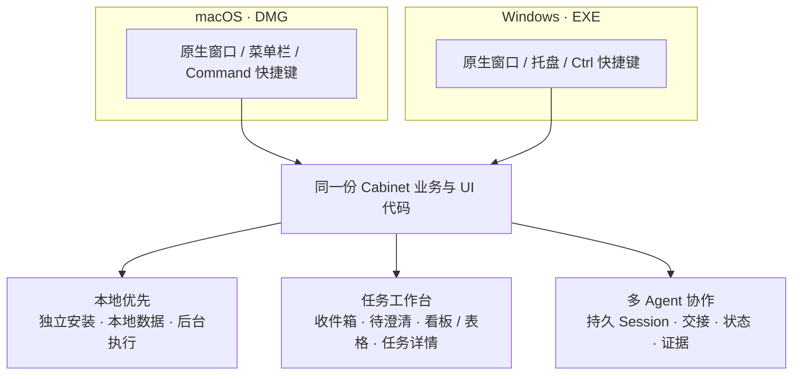

# Cabinet 桌面客户端重构规划（B′ 修订版）

> 日期：2026-11-25  
> 状态：设计规划，待实施与实际双平台验收  
> 范围：Electron 桌面化、运行时工程化、低成本前端拆分、安装与分发  
> 产品基线：[ROADMAP.md](../../ROADMAP.md)、[阶段 1A 实施计划](2026-11-24-session-1a-implementation.md)、[Session 与协作规划](../session-collaboration.md)  
> 本文不代表功能已实现；现有产品路线、数据模型、任务语义和项目边界继续有效。

## 0. 摘要

采用 **B′：先验证 Electron 桌面化，保留现有 Node.js、SQLite 和原生前端；再按实际维护问题进行文件级拆分，框架升级按需另行决策**。

桌面化、前端工程化、技术栈升级是三个独立的问题。当前真正需要解决的是产品形态，而不是业务核心无法支撑发展。不要用一次大规模重写换取尚未证实的收益，也不要把项目重新带回基础设施先行、核心业务长期未验证的状态。

> 将 Cabinet 从基于本地 HTTP 服务的 Web 应用，演进为本地优先、跨平台、可独立安装、具备后台执行能力的多 Agent 协作桌面客户端，同时保持业务核心、数据资产、项目边界和现有功能的连续性。

目标是 Windows 与 macOS 使用同一份业务和界面代码，用户安装后直接打开，无需手动启动 Node 或系统浏览器；支持本地 Agent、原生目录选择、文件操作、托盘、通知、快捷键、后台运行。未来可以按需增加自动更新和远程管理，但跨平台安装不等于跨设备数据同步。

不追求技术栈的先进性，不因重构扩大产品边界，不提前建设尚未证实需要的复杂架构。

## 1. Design Review 与方案选择

### 1.1 三种改造思路

| 方案 | 范围 | 判断 |
| --- | --- | --- |
| A：Electron 套壳 | 现有 HTTP Server + BrowserWindow，原有 UI | 适合验证，不是完整长期方案 |
| B：桌面化 + 全面前端工程化 | Electron、运行时隔离、React/Vite/Zustand/Radix 等、Monorepo | 桌面化成立；一次性换前端技术栈和搬迁目录超出当前必要 |
| C：完全重写 | 业务、存储、执行框架、前端全部重写 | 不采用，风险最高 |
| **B′：渐进桌面化** | A 验证 → 最小运行时契约 → 结合 1B/1C 完善 → 测试保护下拆分原生前端 | **采用** |

评审提出的核心判断：B 的桌面化部分满足长远设计，先 A 再 B 的顺序合理；前端工程化的目标成立，但同时引入多套依赖和七层 Monorepo，会用大量回归风险换取尚未证实的收益。评审中的“约两周”是风险估计，不是实际工期。

### 1.2 逐模块评审

| 规划项 | 原方案/评审判断 | B′ 最终决策 |
| --- | --- | --- |
| Electron 壳 + 打包 | 必要；已有 start() 入口可复用 | 确定，D0 实际打包验证 |
| UtilityProcess | 业务含同步 SQLite、JSONL 和子进程，不宜阻塞主进程 | 首选，须验证实际兼容性 |
| 保留 HTTP API | 必要，但双接口缺契约 | HTTP 承载业务，IPC 承载有限系统能力，不重写业务接口 |
| board.html → React | 文件过大是真问题，换框架此刻不必要 | 先测试、原生 ESM 文件级拆分，框架按需 |
| Monorepo | 当前单包，迁移会影响既有脚本、调试路径 | 不纳入本次范围 |
| TypeScript、Vite、状态库 | 可选后置，不能损伤 Node 独立运行及 CLI | 保留 JS ESM，渐进 JSDoc |
| 原生目录选择 | 已有 PowerShell、AppleScript 原生对话框 | 替换为 Electron dialog，低成本适配 |
| 托盘、通知、快捷键、开机自启 | 桌面化的实际收益 | 分阶段实现，尤其 Agent 完成/待确认通知 |
| 签名、公证、自动更新 | 自用可后置 | D0 手工安装包；D3 完善 |
| 原有数据目录 | 必须保留，否则老数据看似消失 | 强制要求，数据与 Electron 缓存分离 |
| 单实例 | server.lock 与 Electron 锁应明确归属 | 强制要求，Runtime 数据锁与桌面实例锁分离 |
| 前端回归测试 | 原测试主要在 Node 层 | 拆分前强制门禁 |
| D1 与 1B/1C | 同时修改同一批文件存在风险 | 拆成 D1A、D1B，串行控制共享文件变更 |
| 多 Agent 修改 board.html 的冲突 | 目前是假设；真实依据是界面问题和频繁修改 | 以维护成本、回归风险为拆分理由，不声称已发生并发冲突 |

原评审给出的 board.html 约 6513 行（CSS 1789、JS 4350、HTML 360）、server.mjs 约 54 KB、ISSUES.md 约 98 KB，均为评审时快照量级，实施时应重新测量，不作为硬性指标。原先已有 Node 测试（test-sqlite、test-agent、test-parsers、style-audit 等），前端自动化覆盖不足，必须先建立基线。

### 1.3 五项修正

1. D0 不能只是打开一个 Electron 窗口。必须验证 SQLite、CLI、数据目录、锁、打包环境及安全访问；不能只看 Electron 内置 Node 版本推断 node:sqlite 可用性。
2. D1 不全部排在 1B/1C 后面。D1A 先定义最小运行时契约；D1B 随 1B/1C 补齐恢复、退出、交接和后台管理，不让两批开发同时修改共享文件。
3. 保留业务数据目录，不意味着 Electron userData 也指向它。窗口配置和 Chromium 缓存应独立，避免清缓存或卸载误伤业务数据。
4. 安全边界在 D0 就成立：回环地址不是身份验证；限制 HTTP、IPC、导航、外链、附件及不可信 Markdown。
5. React 不是必经阶段。原生模块能支撑长期维护，就不迁移框架。

## 2. 当前源码基线与风险

本规划基于 2026-11-25 读取的 GitHub 默认分支及设计评审；README 表明 1A（OpenCode 持久 Session、Turn、重启恢复、项目默认 Agent/模型）已实现，下一步是 1B、1C。未对实现进行双平台运行验收。

| 源码位置（当时快照） | 当前机制 | 风险与处理 |
| --- | --- | --- |
| [server.mjs:113](../../task-inbox/server.mjs#L113) | 检查 PID 后写 server.lock | 检查/写入非原子；并发启动有竞争，需原子锁、所有者验证及安全回收 |
| [server.mjs:1158](../../task-inbox/server.mjs#L1158) | 导出 start(core, opts) | 仅服务启动，不含完整锁、初始化与关闭流程 |
| [server.mjs:1199](../../task-inbox/server.mjs#L1199) | CLI 入口负责数据目录、锁、初始化 | Electron 直接调用 start() 会绕过部分生命周期 |
| [server.mjs:1183](../../task-inbox/server.mjs#L1183) | 回环监听、端口冲突时回退 | 端口不是 Runtime 身份，不能绕过数据锁 |
| [backend.mjs:142](../../task-inbox/backend.mjs#L142) | process.execPath 运行 JS CLI | Electron 中可能指向 Electron 可执行文件而不是独立 Node |
| [opencode-agent.mjs:157](../../task-inbox/opencode-agent.mjs#L157) | --auto 非交互执行 | HTTP、渲染层、IPC 成为重要安全边界 |
| [server.mjs:1249](../../task-inbox/server.mjs#L1249) 附近 | 关闭 Runner、关库、释放锁 | 需要共享退出流程，先收子进程再关库 |

因此 D0 “业务代码零改动，只改 process.execPath”过于乐观。应保留业务规则，但提取公共 Runtime 启动/关闭入口，共享锁、初始化、恢复、收尾逻辑。

ELECTRON_RUN_AS_NODE=1 可以作为兼容方案，但必须集中管理：如果 runAsNode fuse 被关闭，该环境变量会被忽略。不能默认向所有子进程传播 Electron 专属变量。实际打包后应验证 JS CLI 和原生二进制两条调用路径。

### 2.1 模块改造范围

| 模块 | 处理 | 相对程度 |
| --- | --- | --- |
| core.mjs | 保留业务规则 | 低 |
| storage.mjs | 保留 SQLite，验证运行时与迁移 | 低 |
| classify.mjs、brief.mjs、chat.mjs | 复用现有模型与任务逻辑 | 低 |
| backend.mjs | CLI 运行时、环境变量适配 | 低至中 |
| agent.mjs、opencode-agent.mjs | 进程管理、退出及恢复 | 中 |
| server.mjs | 共享生命周期、HTTP 安全契约、静态资源服务 | 中 |
| board.html | 不重写；逐步拆分 | 渐进 |
| browse.mjs、pickdir.ps1、AppleScript | 桌面优先原生选择器，保留独立模式降级 | 低 |
| .cmd / .command | 暂保留，桌面模式由 Electron 接管 | 渐进 |
| Electron、安装包、托盘、通知 | 新增桌面模块 | 新增 |

以上为定性判断，不是代码量统计。

## 3. 产品边界与长期架构

### 3.1 三层职责



Cabinet 负责任务整体、Agent 分配、Session 管理、交接、进度和交付，不重新实现 Agent Harness、代码编辑器、项目知识库、项目记忆、项目规范或独立项目 Roadmap。

Project 是轻量逻辑组织对象：任务归属、工作目录、默认 Agent/模型、关联任务与执行记录。Cabinet 可以引用仓库中的知识，但不拥有、不独立维护它。TaskContext 是任务协作共识，不是 Project Context。

### 3.2 当前架构与目标架构



Electron 自带 Chromium 和 Node 运行环境；桌面版不要求用户安装系统 Chrome 或为 Cabinet 单独安装 Node（外部 Agent 的自身运行依赖仍需满足）。

### 3.3 详细技术架构



**Electron 是宿主，Runtime 是产品，Renderer 是交互界面。** 即使以后更换桌面框架，业务仍可独立运行。主进程只负责桌面生命周期；同步数据库操作、JSONL 处理、Agent 子进程等放在独立业务进程中，避免阻塞窗口。

| 层级 | 负责 | 不负责 |
| --- | --- | --- |
| Renderer | 展示、交互、前端状态 | 直接访问数据库、执行命令 |
| Preload | 暴露有限系统能力 | 通用 Node API |
| Main Process | 窗口、托盘、通知、Runtime 生命周期 | 任务规则、数据库操作 |
| Runtime | 任务、Session、Agent、协作 | Electron 窗口管理 |
| Storage | 持久化、迁移、备份 | 业务决策 |
| Agent Adapter | 外部调用、事件转换、状态核对 | 自行跨任务分配 |

UtilityProcess 是首选隔离方式，不等于独立于 Electron 主程序的系统守护进程。首期只承诺关窗后继续运行，不承诺完全退出应用、休眠或系统关机后仍在执行。若未来需要完全脱离桌面应用运行，应单独评审 daemon 方案。

## 4. 技术选型

| 技术层 | 选型 | 决策 |
| --- | --- | --- |
| 桌面框架 | Electron | 新增；版本下限 ≥ 35.0.2（自带 Node 22.14，`node:sqlite` 默认可用），实施时取 npm 当前稳定版并在双平台安装包内实测 |
| 前端 | HTML / CSS / JS | 保留 |
| 前端模块化 | ES Modules | 渐进新增 |
| 前端构建工具 / UI 框架 | 无 | 暂不引入 |
| 视觉规范 | STYLE.md + CSS Variables | 保留银灰、拟态、玻璃体系 |
| 开发语言 | JavaScript ESM | 保留 |
| 类型检查 | JSDoc + 按需检查 | 渐进 |
| 后端 | Node.js | 保留 |
| 数据库 | SQLite / node:sqlite，保留已有适配层 | 实测 |
| API | 现有 HTTP | 保留并加固 |
| 桌面系统接口 | Electron IPC | 新增 |
| 后台进程 | UtilityProcess | 首选，待实测 |
| Agent 执行 | Child Process + Adapter | 保留 |
| 单元测试 | 现有 Node 测试 | 保留 |
| UI 自动化 | Playwright | 新增 |
| 包管理 | npm + lockfile | 新增 |
| 打包 | electron-builder | 新增 |
| 自动构建 | GitHub Actions | 后续 |

不纳入本次：React、Vue、Vite、Zustand、Tailwind、Radix、dnd-kit、TanStack Table、React Flow、Redis、PostgreSQL、Kubernetes、复杂 Monorepo。它们不是禁止使用，而是需要实际问题与单独决策支撑。

## 5. 工程目录

保留 task-inbox 和现有 clone 即跑方式，不大规模搬迁。以下是逐步形成的目标结构，不要求第一天创建所有空目录。

```text
Cabinet/
├── electron/
│   ├── main.mjs             # 应用入口、生命周期
│   ├── preload.cjs          # 安全 IPC
│   ├── window.mjs           # 主窗口、随手记窗口
│   ├── tray.mjs             # 托盘与菜单
│   ├── runtime-host.mjs     # 业务进程管理
│   └── ipc.mjs              # 有限系统能力
├── task-inbox/
│   ├── runtime.mjs          # 新增：共享启动与关闭入口
│   ├── core.mjs
│   ├── server.mjs
│   ├── storage.mjs
│   ├── agent.mjs
│   ├── opencode-agent.mjs
│   ├── backend.mjs
│   ├── classify.mjs
│   ├── brief.mjs
│   ├── chat.mjs
│   ├── browse.mjs
│   ├── cli.mjs
│   ├── board.html           # 前端入口
│   ├── web/                 # 渐进拆分
│   │   ├── styles/
│   │   ├── components/
│   │   ├── views/
│   │   ├── api.js
│   │   └── state.js
│   ├── STYLE.md
│   ├── style-audit.mjs
│   └── 现有脚本与测试
├── tests/                   # E2E 与桌面测试
├── resources/               # 图标、安装包资源
├── docs/
├── package.json
├── package-lock.json
├── electron-builder.yml
└── ROADMAP.md
```

`runtime.mjs` 与 `server.mjs` 的职责在 D0 就写死，不允许两处都管生命周期：

| 文件 | 负责 | 不负责 |
| --- | --- | --- |
| `runtime.mjs` | 数据锁、初始化/迁移、归档扫描、恢复核对、start/shutdown 顺序与释放锁 | HTTP 路由、界面 |
| `server.mjs` | `createHandler` + `start(core, opts)`（监听、端口回退） | 数据锁、初始化、恢复、收尾 |
| `cli.mjs` / 独立运行入口 | 解析参数 → 调 `runtime.mjs` | 自己实现生命周期 |

`node server.mjs` 仍要可用：入口就是 `runtime.start()`。这样 D1A 的 Runtime Contract 固化的只是已有形态，不是新造一套。

保留原 .cmd、.command、CLI、Node 测试及原有调试方式；只有桌面版本稳定后才评估废弃脚本。静态文件拆分时同步维护服务路径、打包资源、安装复制清单、样式检查、代码版本识别与热更新行为。

## 6. 实施路线图

产品路线 P 解决 Cabinet 能做什么；工程路线 D 解决如何运行、维护、安装、分发。两者有关联但不混为一个产品里程碑。



图为推荐顺序与协同关系，不是严格 DAG 或固定工期；双向线表示协调，不表示循环依赖。D0 包含手工安装包和最小安全/运行时门禁，D1A 是验证后的契约固化，不重复建设。前端测试可以提前独立开展。D1B 与 1B/1C 按变更所有权协调，禁止两个开发任务同时无协调修改 server.mjs、Runner 等核心文件。

### 6.1 D0：最小桌面客户端验证（最高优先级）

目标：独立安装、启动、运行、退出，保持现有界面与业务行为。

实施清单：

- [ ] 新增 Electron 应用入口、依赖锁定和打包配置。
- [ ] 加载现有 board.html，不修改布局、样式、任务规则。
- [ ] 实现共享 Runtime 启动/关闭入口，保留 Node 独立模式。
- [ ] 实测 UtilityProcess 与 node:sqlite；验证打包后可读写、迁移和重启。
- [ ] 固定业务数据目录，保留 TASK_INBOX_DATA；处理原子数据锁与旧服务冲突。
- [ ] 建立本地 HTTP 访问认证及 IPC 安全隔离；默认拒绝未授权调用。
- [ ] 使用 dialog.showOpenDialog 实现原生目录选择，保留独立运行模式原逻辑。
- [ ] 建立基本托盘/窗口管理，明确关窗与完全退出的区别。
- [ ] 构建 Windows x64 EXE、macOS ARM64 DMG。
- [ ] 验证 Magpie 分类、OpenCode 多轮会话与原 Session 恢复。

| 编号 | 验收标准 | 状态 |
| --- | --- | --- |
| D0-01 | 不依赖系统 Node.js/Chrome 启动 Cabinet；外部 Agent 依赖另行检查 | 待验收 |
| D0-02 | Windows、macOS 安装、启动、关闭正常 | 待验收 |
| D0-03 | 旧任务、附件、项目、配置、Session/Turn 无丢失 | 待验收 |
| D0-04 | 新增任务并通过 Magpie 分类 | 待验收 |
| D0-05 | OpenCode 完成两轮对话，复用外部 Session ID | 待验收 |
| D0-06 | 重启后仍能定位原 Session | 待验收 |
| D0-07 | 重复打开不启动第二个 Runtime；原独立服务冲突时安全拒绝 | 待验收 |
| D0-08 | 完全退出不遗留非预期子进程，不误杀无关进程 | 待验收 |
| D0-09 | 未授权本地 HTTP 请求不能触发 Agent；不可信页面不能访问通用系统能力 | 待验收 |
| D0-10 | 原 Node 启动、CLI、测试可用 | 待验收 |

补充实测：从 Windows 桌面图标、macOS Finder/Dock 启动的 PATH；中文路径、带空格路径；JS CLI 与二进制；数据目录中旧库与附件的真实备份/恢复；应用自身在没有系统 Node 的机器运行。D0 未通过不进行前端框架迁移、目录大搬迁或业务重写。

### D0 实施进展（2026-11-26，仅 Windows，部分验收）

已完成并实测：

- Electron 壳与 `UtilityProcess` Runtime 已落地（`electron/main.mjs`、`runtime-host.mjs`）：单实例、托盘、关窗隐藏、退出前协调 shutdown。
- 共享 Runtime 入口 `task-inbox/runtime.mjs` 已抽出：数据锁、初始化/迁移、归档扫描、恢复、关闭顺序只此一处；`node server.mjs`、CLI 与原测试行为不变。
- Windows x64 NSIS 安装包可构建（`release/Cabinet Setup 0.2.0.exe`），未签名；`release/` 不入库。
- 打包后的 `Cabinet.exe` 实测：自带 Node v24.22.3，`node:sqlite` 可读写建库；用热备份的老库启动得到 29 条任务，与在跑服务一致；重复启动只激活已有实例，不产生第二个 Runtime；加载看板后 `/api/ping` 成功，退出无遗留进程。
- 默认数据目录被独立 Node 服务占用时，桌面端按 `ELOCKED` 安全拒绝，不落 46002。
- 本地接口认证已实现：桌面 Runtime 每进程生成高熵 token，`/api`、`/images`、`/files` 需 header 或 `?t=`；页面本身可匿名加载；独立 Node 模式不传 token，行为与现在完全一样。实测未带凭据 `401`、页面 `200`，打包冒烟通过。
- D0-04 已在桌面包内跑通：`--smoke-classify` 真收一条任务、经 Magpie 分类落库后删除，`classify=OK`。
- D0-05/06 已跑通（Runtime 同一入口，Node 模式）：OpenCode 两轮都返回预期原文，`turn_count=2`；强杀进程重启后 `external_session_id` 不变，`reconcile` 能对回原 Session 且末轮为 `completed`。
- 原生目录选择已接入：`preload` 暴露 `pickDirectory()`，Main 用 `dialog.showOpenDialog`，页面优先走 IPC、失败再退回 `/api/pickdir`；冒烟确认 bridge 存在，真实点选仍需人工一次。

仍待验收：

- 原生目录选择的实际点选、macOS DMG、代码签名未做。
- IPC 目前只有凭据与选目录两项；通知、开机自启等能力未新增。
- 附件与 `sessions/` 事件文件只验证了随目录迁移，未逐项打开核对。


### 6.2 D1A：桌面运行时基础契约

D0 通过后，将验证代码固化成稳定机制。

| 契约 | 内容 |
| --- | --- |
| Runtime Contract | start / ready / health / shutdown / error；真实端口及实例身份；启动失败与超时处理 |
| Data Contract | 数据目录、SQLite、附件、Session、备份、迁移兼容 |
| Instance Contract | 桌面实例锁、Runtime 数据锁、端口归属、冲突与陈旧锁恢复 |
| Agent Contract | 启动、停止、超时、事件、状态、CLI 环境 |
| Security Contract | HTTP 认证、Host/Origin 校验、IPC 白名单、文件访问范围 |

不新增一套 IPC 业务接口；Electron 与独立 Node Server 共用启动、初始化、恢复、退出。CLI 保留现有功能，并明确涉及执行状态的并发写入约束。锁必须在恢复 Turn、打开可写业务库之前获得；退出时仅释放本实例拥有的锁。

### 6.3 D1B：后台运行及 Agent 生命周期

结合 1B/1C 完成任务状态、证据、恢复与交接机制。



| 操作或事件 | 行为 |
| --- | --- |
| 关闭窗口 | 隐藏至托盘，Agent 继续执行 |
| 最小化 | 正常运行 |
| 再次打开 | 恢复窗口与任务状态 |
| 主动退出，无运行任务 | 正常关闭 Runtime |
| 主动退出，有运行任务 | 选择继续后台、取消退出或停止任务并退出 |
| Renderer 崩溃 | 恢复界面，不影响 Runtime |
| Runtime 崩溃 | 记录异常，受限重启并核对任务状态 |
| 系统休眠 | 唤醒后核对进程与 Session |
| 系统重启 / 断电 | 未确认结果标记为待核对，不盲目重跑 |
| Agent 执行结束 / 等待确认 | 真实事件驱动通知，结果持久化 |



恢复不等于重跑：Agent 可能已经修改代码，只是最后一条事件未送达。必须区分成功、失败、取消、未知/待核对，不能仅凭进程退出判为完成。异常中止后不得自动重复有副作用的 Turn；如果旧 Agent 仍在运行，不允许无条件启动同一 Session 的新 Turn。

D1B 验收：关窗再开、Renderer 崩溃、杀壳、杀 Runtime、系统休眠/恢复、模拟异常断电/重启等场景，确认日志、证据和状态一致，无盲目重跑或孤儿进程。使用隔离测试库，不对真实用户数据做破坏性故障注入。联合 1B/1C 验收 A → B → 原 A 的持久 Session 交接。

### 6.4 D2：低成本前端工程化

目标是降低维护成本，不是更换框架。先建立回归基线，再逐个模块拆分，每一步可独立回退。

| 顺序 | 任务 | 验收 |
| --- | --- | --- |
| D2.0 | Playwright 基线 | 固化关键交互和必要的视觉快照 |
| D2.1 | CSS 提取 | 布局、颜色、响应式与材质降级不变 |
| D2.2 | API 提取 | 现有业务接口、错误和事件行为不变 |
| D2.3 | 共享状态提取 | 看板/表格/筛选状态一致 |
| D2.4 | 通用组件 | 弹窗、抽屉、选择器、通知 |
| D2.5 | 视图拆分 | 看板、表格、详情、Session |
| D2.6 | 清理重复代码 | 原有测试、样式检查、UI 回归通过 |
| D2.7 | 框架必要性评估 | 若实际痛点成立，另立 ADR/技术决策；否则不做 |

前端回归门禁：

- [ ] 任务新增、自动分类、待澄清。
- [ ] 看板拖拽换列。
- [ ] 任务拆分、合并、层级与依赖。
- [ ] 详情抽屉、页签切换。
- [ ] 表格行内编辑、排序、筛选。
- [ ] Agent Session 发送、停止、恢复。
- [ ] 项目切换、原生目录选择。
- [ ] 归档与取回。
- [ ] 附件上传、预览。
- [ ] 桌面窗口关闭、恢复。

测试优先使用可重复的假模型/Agent 事件与隔离数据目录，另保留真实 Magpie/OpenCode 冒烟验证。不要让所有 UI 测试依赖真实模型调用。

保持无构建工具的原生 ESM；复杂任务树、依赖图、多 Session 并排、共享状态的维护成本确实超过当前模式时，才评估 React/Vue 等方案。若决定迁移，按功能垂直切片、独立回归、逐项引入状态库/拖拽/表格/图组件，而不是一次性替换全部 UI。

### 6.5 D3：安装与分发

D0 已包含可安装的手工构建；D3 是分发体系完善。

| 功能 | 自用版本 | 对外发布 |
| --- | --- | --- |
| Windows EXE（NSIS/x64） | 必须 | 必须 |
| macOS DMG（ARM64） | 必须 | 必须 |
| GitHub Actions 多平台构建 | 建议 | 必须 |
| Windows ARM64 | 按需 | 按需 |
| macOS Intel | 按需 | 按用户群体 |
| Windows 应用签名 | 可后置 | 强烈建议 |
| macOS Developer ID / 公证 | 可后置 | 常规外部分发应具备 |
| 自动更新 | 后置 | 按需 |
| 更新前数据备份 | 必须 | 必须 |
| 升级失败回退 | 手动方案 | 完善机制 |
| 用户诊断日志 | 基础 | 完善 |

自动更新不能中断在跑 Turn 后直接替换程序；需先检查活跃任务、用户确认、备份、校验升级与恢复路径。应用二进制回退不自动意味着数据库 schema 可回退，需验证备份恢复方案。

自用阶段可先使用手动安装包。未签名/未公证包可能受到系统安全限制，不承诺右键即可在所有 macOS 版本打开。外部发布需求、Apple Developer 账号、签名凭据尚待确认；不提前增加账号、许可、云同步或商业化功能。

## 7. 六项强制架构原则

### 7.1 数据独立于应用

业务数据继续使用原有默认目录及 TASK_INBOX_DATA 覆盖机制。

```text
~/.config/cabinet/
├── tasks.db              # 业务真相（WAL），已存在
├── tasks.json            # 仅旧版本遗留，首次建库后改名留档，已存在
├── images/               # 贴进来的图（core.mjs:68），已存在
├── files/                # 其他附件（core.mjs:69），已存在
├── sessions/             # 每轮 Agent 事件 JSONL（core.mjs:1872），已存在
├── server.lock          # Runtime 数据锁，已存在
├── logs/                 # 桌面模式新增，当前不存在
└── backups/              # 桌面模式新增，当前不存在
```

叶子目录必须与代码一致：实际是 `images/` 和 `files/`，**没有 `attachments/`**。`logs/`、`backups/` 是桌面模式要新增的目录，实施时先建目录再写日志/备份，不能假设它已存在。Windows 为用户 home 下的 .config/cabinet；macOS 同理。Electron userData（例如 Windows %APPDATA%/Cabinet、macOS ~/Library/Application Support/Cabinet）仅保存桌面配置和 Chromium 缓存。

迁移前对 SQLite 做一致性热备份或在正常关库后备份，并包含附件、Session 日志及必要配置；不能直接复制活跃 WAL 数据库的单个文件。验证恢复后才升级。检查历史 Alma 目录数据与现行目录，禁止静默新建空库造成数据“消失”。

同一机器的 CLI 和桌面端共享业务数据，但执行、恢复和迁移写入应有明确并发约束。禁止用网盘直接同步活跃 SQLite/WAL 实现多设备实时共享；跨设备是后续独立议题。

### 7.2 同一数据目录只允许一个 Runtime 所有者



Electron 锁负责桌面实例；Runtime 数据锁负责业务所有权。首期不自动接管或杀死旧 Node 服务，不通过端口回退绕开锁。锁需原子获取、规范化数据目录路径、区分陈旧锁和活跃进程，防止 PID 复用或退出时误删他人锁。若桌面壳崩溃而 Runtime/Agent 存活，先核对所有者与状态，再允许恢复。

### 7.3 HTTP 与 IPC 职责分离

| 操作 | HTTP | IPC |
| --- | :---: | :---: |
| 查询任务、Agent 状态 | ✓ | |
| 新增、编辑任务 | ✓ | |
| 拆分、合并、依赖 | ✓ | |
| Session 发送、停止 | ✓ | |
| 选择本地目录 | | ✓ |
| 打开受控附件 | | ✓ |
| 窗口控制 | | ✓ |
| 系统通知 | | ✓ |
| 开机自启 | | ✓ |

Main 与 Runtime 有内部生命周期和事件通道，和 Renderer 白名单 IPC 区分。禁止暴露通用 exec、任意 readFile 或原始 ipcRenderer。系统通知应基于真实 Runtime 事件，不接受任意网页触发。

### 7.4 安全优先于便利

Renderer 使用 nodeIntegration: false、contextIsolation: true、sandbox: true。Preload 每个 IPC 只暴露明确语义、校验参数及调用来源。

Runtime 默认绑定回环地址；应用实例认证使用高熵随机凭据、安全传递、Host/Origin 校验及必要 CSRF 防护；避免在 URL、日志或不可信页面中暴露凭据。认证不能依赖端口或仅靠 CORS。独立 Node HTTP 模式也需相应保护，CLI/浏览器调试方式需定义兼容机制。

凭据下发只有一条路径：Main 进程启动时生成高熵随机 token → 经 preload 的有限 IPC（或一次性启动参数）交给 Renderer → Renderer 只在统一封装 `api()`（board.html:3781）里附加请求头。不把 token 写进 URL、持久化到 localStorage 文件或打进日志。现有页面只有一个 `fetch` 封装，所以认证接入必然改动 board.html 这一处；D0 清单里的“不修改布局、样式、任务规则”**不涵盖**认证接入，实施时单独提交、单独验收。

对外链、导航、新窗口、下载、附件路径进行限制；安全处理 Agent 输出、Markdown、HTML、链接、项目文件；设置适当 CSP，拒绝不可信脚本和任意权限请求。不使用关闭 webSecurity 的方式绕过开发问题。--auto Agent 权限是高影响能力，应明确工作目录与授权边界，不能让网页通过通用 IPC 执行任意命令。

### 7.5 集中管理平台差异

统一处理 CLI 路径与环境、Windows CMD/EXE 与 macOS 可执行程序、子进程树、中文/空格路径、系统快捷键、通知、托盘、自启；不要让每个业务模块单独判断操作系统。

| 能力 | Windows | macOS |
| --- | --- | --- |
| 安装包 | Cabinet-Setup-x64.exe | Cabinet-arm64.dmg |
| 窗口 | 系统窗口 | 系统窗口 |
| 文件选择 | 原生对话框 | 原生对话框 |
| 快捷键 | Ctrl | Command |
| Agent 运行 | EXE/CMD/Shell | Unix 可执行文件 |
| 托盘 | 任务栏通知区域 | 顶部菜单栏 |
| 自启 / 通知 | 系统接口 | 系统接口 |
| 签名 | Authenticode | Developer ID / Notarization |

重点验证图标/Finder 启动 PATH（与终端不同）、macOS Homebrew/launch 环境、Windows npm shim、进程树终止、文件权限。首批仅承诺 Windows x64 与 Apple Silicon macOS；其他架构按需。

### 7.6 不允许重构造成功能倒退

不得顺带改变任务状态、依赖规则、Session 数据模型、现有产品交互、视觉规范或项目职责。产品变更建立独立任务；确需 schema 修改时遵循已有迁移机制，提供备份、恢复与兼容测试。每个小阶段保留可回退提交、测试证据及已知缺陷。

## 8. 桌面能力范围

| 能力 | 目标 |
| --- | --- |
| 原生目录选择 | 获取本地项目绝对路径，桌面模式不再依赖脚本 |
| 独立应用窗口 | 记住位置/尺寸，按需支持随手记窗口、多窗口 |
| 全局快捷键 | 从其他软件唤起随手记 |
| 系统通知 | Agent 完成、等待确认、失败 |
| 系统托盘 | 关窗后后台执行，明确完全退出 |
| Agent 环境诊断 | 检测 CLI 安装位置、版本、模型配置、状态 |
| 文件操作 | 受控附件、项目目录及默认编辑器 |
| 开机自启 | 应用设置管理，尊重平台行为 |
| 安装更新 | 手工安装优先，安全自动更新后置 |

以上能力分阶段实现，不要求 D0 一次完成，也不意味着 Cabinet 成为代码编辑器或模型网关。

## 9. 文档组织与维护

本次先以一份完整文档保存设计、路线、关系图和验收，避免多个文件重复维护；后续规模增加再按以下职责拆分。

| 文件 | 职责 | 处理 |
| --- | --- | --- |
| README.md | 产品定位、安装方式、状态与文档入口 | 补充入口，功能未实现前不改状态 |
| ROADMAP.md | 产品路线 | 保持原路线，实施时可少量补桌面里程碑入口 |
| docs/plans/desktop-migration.md（本文） | 当前完整桌面方案与验收 | 新增 |
| docs/desktop-architecture.md | 长期稳定架构与契约 | 按需从本文提取，不重复 |
| docs/frontend-engineering.md | ESM 拆分与框架触发条件 | 按需提取 |
| AGENTS.md | 开发规则、重构限制 | 实施阶段按需新增/完善 |
| task-inbox/STYLE.md | 现有视觉标准 | 保留 |
| task-inbox/ISSUES.md | 具体缺陷 | 不混入本规划 |

## 10. 优先级、依赖与工作量

| 优先级 | 内容 | 开展时机 |
| --- | --- | --- |
| P0 | 最小 Electron 客户端 | 立即 |
| P0 | 数据、实例锁、安全、兼容性 | D0 |
| P0 | Windows / macOS 安装包 | D0 |
| P1 | Runtime 基础契约 | D0 验证后固化 |
| P1 | 产品 1B / 1C | 按原路线，与 D1B 协同 |
| P1 | 托盘、通知、后台生命周期 | D0 基础 + D1 完善 |
| P1 | 前端测试基线 | 尽早独立建立 |
| P2 | 前端文件级拆分 | 基线通过后渐进 |
| P2 | GitHub Actions 构建 | 安装包稳定后 |
| P3 | 签名、公证、自动更新 | 分发需求明确后 |
| P4 | React 等框架 | 实际必要时重新评估 |
| 不规划 | Monorepo、核心重写、云服务 | 当前不做 |

原评审提出 D0 半天、前端拆分 3–5 天，只能作为粗略工作量假设，不是承诺。实际估算以两个平台打包、CLI 和数据锁验证为前提。不要并行修改同一核心文件；先冻结共享契约，再开展可独立测试的开发任务。

## 11. 最终产品形态



界面保留现有 Cabinet 银灰、橙色强调、拟态与玻璃视觉体系，保持看板、表格、详情和随手记的原有布局；增加独立窗口及必要桌面入口，不借机重新设计产品。上述为目标示意，不是实际运行截图。

**Local-first Multi-Agent Desktop Workspace：本地优先的多 Agent 桌面工作台。** 不是手动启动服务的网页，也不是另一个 Codex/OpenCode Harness。

## 12. 待决策与未验证项

| 项目 | 当前假设 / 决策 | 验证方式 |
| --- | --- | --- |
| 是否对外分发 | 首期自用，保留未来可能性 | 使用者明确需求后进入 D3 |
| 前端是否持续做大 | 不预设一定换框架 | D2 后评估真实维护成本 |
| Apple Developer 账号 | 未确认 | 对外分发前确认 |
| Electron 具体稳定版本 | 下限 ≥35.0.2（`node:sqlite` 可用性由它决定）；D0 内锁定一个具体版本 | 在 `package.json` 记录版本，并在双平台安装包内实测 `node:sqlite` 读写、UtilityProcess 与重启 |
| node:sqlite / UtilityProcess | 尚未实际验证 | 双平台安装包中读写及重启 |
| 图标启动 PATH / macOS launch 环境 | 尚未实际验证 | Finder、Dock、桌面快捷方式启动真实 CLI |
| 现有本地 dev 与远端 main 是否一致 | 未确认 | 实施前比对本地分支及最新提交 |
| Mermaid 图 | 设计示意 | GitHub 渲染与实际实现后复核 |

本次规划评审只读取仓库，没有修改业务代码、没有构建或运行 Electron 安装包。已有 1A 状态来自仓库 README，实际运行仍需验收。所有 D0–D3 清单均为待实施内容，不表示已完成。本文为完整规划归档，不自动替代产品 ROADMAP。

参考 Electron 官方文档（实施时复核所选版本）：

- [Process Model](https://www.electronjs.org/docs/latest/tutorial/process-model)
- [UtilityProcess](https://www.electronjs.org/docs/latest/api/utility-process)
- [Security](https://www.electronjs.org/docs/latest/tutorial/security)
- [Context Isolation](https://www.electronjs.org/docs/latest/tutorial/context-isolation)
- [IPC](https://www.electronjs.org/docs/latest/tutorial/ipc)
- [Fuses](https://www.electronjs.org/docs/latest/tutorial/fuses)
- [Environment Variables](https://www.electronjs.org/docs/latest/api/environment-variables)
- [App](https://www.electronjs.org/docs/latest/api/app)
- [Dialog](https://www.electronjs.org/docs/latest/api/dialog)
- [Code Signing](https://www.electronjs.org/docs/latest/tutorial/code-signing)

## 13. 最终决策

**确定 Electron，保留 Node.js、SQLite 和现有前端；先完成 D0 与最小运行时契约，再继续 1B、1C，最后根据真实使用情况逐步完善前端工程。**

冻结已验证的业务能力，只替换明确需要调整的运行环境；用实际问题驱动后续工程化。保持项目知识归仓库、Agent 负责理解与执行、Cabinet 负责任务整体和协作的边界。
